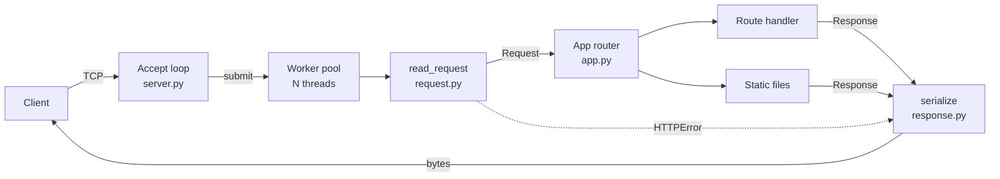

# minihttp: an HTTP/1.1 server from raw sockets

[](https://github.com/iwan-adler/http-server-from-scratch/actions/workflows/tests.yml)

An HTTP/1.1 server written in Python with **only the standard library's `socket` module**. It doesn't use `http.server`, any framework, or any third-party package. It parses requests byte by byte, routes them, serves static files, keeps connections alive, handles many clients at once, and rejects malformed or malicious input with the correct status codes.

It also implements **WebSockets (RFC 6455) from scratch**, and includes a multi-room **real-time chat** built on them.

The goal is to understand what frameworks like FastAPI, and servers like Uvicorn or nginx, do underneath, and to show that understanding in code and tests.

```bash
python -m minihttp.demo --port 8080
curl -i http://127.0.0.1:8080/api/hello/world?greeting=Hi
```
```
HTTP/1.1 200 OK
Date: Tue, 13 Oct 2026 17:13:06 GMT
Server: minihttp
Content-Type: application/json
Connection: keep-alive
Content-Length: 25

{"message": "Hi, world!"}
```

## Features

All of these are implemented and tested.

**Protocol**
- **Request parsing** (RFC 9112): request line, case-insensitive repeated headers, `Content-Length` bodies, query strings, percent-decoded paths, both CRLF and bare-LF line endings.
- **HTTP/1.1 keep-alive** and **HTTP/1.0** close-by-default; `Connection: close` and `keep-alive` are honoured.
- **Pipelining:** several requests sent back to back are answered in order on one connection.
- **`HEAD`** reports the real `Content-Length` but sends no body. `304`, `204` and `1xx` responses never carry a body.

**Application**
- **Routing** with path parameters (`/api/hello/{name}`).
- `404`, and `405` with the correct `Allow` header.
- `HEAD` is allowed wherever `GET` is.
- **Static files:** MIME types, `index.html` for directories, `Last-Modified` and `If-Modified-Since` → `304 Not Modified`.

**Server**
- A bounded worker-thread pool.
- A keep-alive idle timeout and a maximum number of requests per connection.
- Graceful shutdown that lets in-flight requests finish.
- Access logs with status, size and latency.
- A crashing handler returns a clean `500` and the server keeps running; the traceback goes only to the server log.

**WebSockets** ([`minihttp/websocket.py`](minihttp/websocket.py))
- **Opening handshake:** validates `Upgrade`, `Connection`, a 16-byte `Sec-WebSocket-Key` and version 13, and computes `Sec-WebSocket-Accept`. The result is checked against the RFC's own example. An unsupported version gets `426` with the supported version.
- **Framing:**
  - 7-, 16- and 64-bit payload lengths
  - client masking **required**; server frames unmasked
  - text and binary messages
  - **fragmented messages**, with ping/pong/close frames allowed in between
  - UTF-8 validation of text messages
  - a 64 KB message limit
- **Protocol violations get the correct close code:** `1002` for unmasked frames, reserved bits, unknown opcodes, oversized or fragmented control frames, and bad continuation frames; `1007` for invalid UTF-8; `1009` for oversized messages; `1011` when a handler crashes.
- **Close handshake:** the client's close code is echoed, and invalid codes are reported as `1002`.
- **Heartbeat:** if a client is silent for 20 s it gets a ping. With no reply after another 20 s, the connection is treated as dead and closed with `1001`.
- **Graceful shutdown:** open WebSockets get a `1001 Going Away` close instead of blocking shutdown.

**Chat demo** ([`minihttp/chat.py`](minihttp/chat.py), [`public/chat.html`](public/chat.html))
- Rooms with user counts and join/leave notices, plus the last 50 messages sent to newcomers.
- **Validation:** names, rooms, and JSON message shape and length. Bad messages get an error event; they don't drop the connection.
- **Per-user rate limiting:** 10 messages per 10 s.
- **Safe display:** an invalid name or room is refused with close code `1008`. The page renders messages with `textContent`; a message containing `` was tested in a real browser and displayed as text.
- **Reconnection:** the page reconnects with exponential backoff.

## Security: rejecting bad input

The server treats every byte from the network as untrusted. Each defence below has a test.

| Attack or mistake | Defence | Status |
|---|---|---|
| **Path traversal** (`/../secret`, `/%2e%2e/`, `..%5c`) | Resolve the path, then require it to stay inside the static root | `404` |
| **Absolute-path trick** (`/C:%5cWindows%5cwin.ini`) | Same check. In Python, `root / "C:\\..."` *discards* `root` on Windows. With the check removed, this test really read `C:\Windows\win.ini` | `404` |
| **Request smuggling:** conflicting `Content-Length` | Reject when the values differ | `400` |
| **Request smuggling:** `Transfer-Encoding` with `Content-Length` | Chunked encoding isn't implemented, so it's refused rather than misread | `501` |
| **Request smuggling:** space before the colon (`Host : x`), folded headers | Reject | `400` |
| **Header injection** in responses (`\r\n` inside a value) | Serialisation refuses it | n/a |
| **Oversized input** | Request line over 8 KB → `414`; header line over 8 KB or more than 100 headers → `431`; body over 1 MB → `413` | as listed |
| **Slow or idle clients** | Socket idle timeout (5 s by default), then the server closes | n/a |
| **NUL bytes in path, missing `Host` in HTTP/1.1, unsupported version** | Reject | `400` / `505` |

After any malformed request, the server **always closes the connection**: once the parser has lost its place in the byte stream, carrying on would be unsafe.

## Architecture



| File | Responsibility |
|---|---|
| `minihttp/request.py` | Bounded, defensive parser: bytes in, `Request` (or `HTTPError` with a status) out |
| `minihttp/response.py` | `Response` helpers and serialisation (status line, `Date`, `Content-Length`, `Connection`) |
| `minihttp/app.py` | Router with `{param}` patterns, `405`/`Allow`, static files with traversal protection and `304` |
| `minihttp/server.py` | Sockets, worker pool, keep-alive loop, timeouts, access log, graceful shutdown |
| `minihttp/demo.py` | Example app: `/api/time`, `/api/hello/{name}`, `POST /api/echo` (JSON), `/api/boom` (shows `500` handling), static `public/` |
| `bench/bench.py` | Load generator comparing against Python's `ThreadingHTTPServer` |

**Concurrency model, and its trade-off.** One thread accepts connections and hands each to a worker from a bounded pool. That's simple, and correct for blocking handlers. The cost is that an idle keep-alive connection occupies a worker until the idle timeout, so the timeout is short. With thousands of mostly idle connections, an event loop (`selectors` or `asyncio`) would scale better. That's exactly the design choice behind Uvicorn and nginx.

## Benchmark

`python bench/bench.py` runs 16 keep-alive clients × 500 requests for the same small JSON response, best of 3 rounds. It was measured on this project's development laptop: an 8-core Qualcomm ARM64 CPU running **x64 CPython 3.14 under emulation**.

| Server | Requests/s (all 3 rounds) | p50 latency | p95 | p99 | Errors |
|---|---|---|---|---|---|
| minihttp | 4,288 / 4,519 / **4,556** | 3.17 ms | 6.64 ms | 8.58 ms | 0 |
| Python `ThreadingHTTPServer` | 3,872 / 3,883 / **3,930** | 3.63 ms | 7.20 ms | 9.44 ms | 0 |

**How to read this:**
- minihttp was about 15% faster in every round. The likely reason is that the stdlib server parses headers with the heavier `email` package.
- The client threads run **in the same process** as the server and compete for the GIL, so the absolute numbers understate both servers.
- This is a narrow comparison. It does **not** compare with production servers (Uvicorn, nginx), which are far faster and do much more.

## Running it

Requires Python 3.11 or newer; developed and tested on 3.14. The server has no dependencies. The tests need pytest, plus the independent `websockets` client library (`requirements-dev.txt`).

```bash
git clone https://github.com/iwan-adler/http-server-from-scratch.git
cd http-server-from-scratch
python -m minihttp.demo --port 8080          # then open http://127.0.0.1:8080 (chat: /chat.html)
python bench/bench.py                         # benchmark
python -m pip install -r requirements-dev.txt && python -m pytest
```

Using it in your own code:

```python
from minihttp.app import App
from minihttp.response import Response
from minihttp.server import Server

app = App()

@app.route("/greet/{name}")
def greet(request):
    return Response.json({"hello": request.params["name"]})

@app.websocket("/ws/echo")
def echo(ws, request):
    while (message := ws.recv()) is not None:   # None once the client disconnects
        ws.send_text(message)

Server(app, port=8080).serve_forever()
```

## Tests

There are 102 tests, which run in about 19 seconds.

| File | Covers |
|---|---|
| `test_request.py` | Valid parsing, keep-alive rules for 1.0 and 1.1, 14 kinds of malformed request, every `Content-Length` and smuggling case, all size limits |
| `test_app.py` | Path parameters, `405`/`Allow`, static files, MIME types, **6 path-traversal variants**, `304`, serialisation, header injection |
| `test_server.py` | Over **real sockets**: keep-alive on one TCP connection, pipelining, HTTP/1.0, raw malformed bytes, a smuggling attempt, traversal over the wire, `HEAD`, a crashing handler, idle timeout, per-connection request cap, **8 slow requests running in parallel**, graceful shutdown |
| `test_websocket.py` | The RFC handshake example, bad handshakes (`400`/`426`), every length encoding, echo through the **independent `websockets` library**, fragments with an interleaved ping, **11 protocol violations and their close codes** (sent by a raw client that misbehaves on purpose), close handshake, heartbeat timeout, handler crash → `1011`, 20 concurrent connections, shutdown with open WebSockets |
| `test_chat.py` | Broadcast to one room only, capped history, leave notices, 6 kinds of invalid message, rate limiting with a fake clock, invalid names and rooms → `1008` |

To check the tests themselves, I removed the traversal check (7 tests failed) and the conflicting-`Content-Length` check (2 tests failed).

**Bugs the WebSocket tests found while I was building it:**
- **The heartbeat would have broken the connection.** Python's buffered socket file refuses every read after a timeout, so WebSockets now read the raw socket, waiting with `select()`.
- **Shutdown hung while a WebSocket was open,** because handlers only return when their connection ends. Shutdown now closes WebSockets with `1001`. Shutting a socket down from another thread doesn't wake `select()` on Windows, so waits happen in 0.25 s slices.
- **A race between handshake and shutdown** let a connection close with `1000` instead of `1001`. That's fixed, and the test passed 10 of 10 runs afterwards.

## Limitations

These are deliberate scope choices, and each could be the next step:
- **No TLS (HTTPS).** Put it behind a reverse proxy, or wrap the socket with `ssl`.
- **No chunked transfer encoding** in requests (refused with `501`) or responses (bodies are buffered).
- **No HTTP/2**, compression, range requests or `ETag`s.
- **Thread-per-connection** scales to hundreds of connections, not tens of thousands (see *Concurrency model*). Each open **WebSocket keeps a worker for its whole life**, so `workers` caps concurrent WebSockets. A broadcast to a slow client also blocks the sender's thread briefly.
- **No WebSocket extensions** (e.g. `permessage-deflate` compression) and no `wss://` (needs TLS).
- **Chat state is in memory:** rooms and history are lost on restart.
- **Static files are read fully into memory,** which is fine for small sites but wrong for large files (`sendfile` would fix it).
- **IPv4 only** (`AF_INET`).
